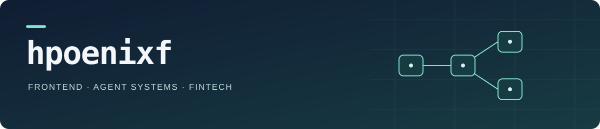

  

  <strong>全栈偏前端 · Agent 系统 · 金融科技</strong> 
  把复杂需求做成可运行的产品，把真实实践写成可复用的经验。

  <a href="https://github.com/hpoenixf/open-etf-agent">Open ETF Agent</a> ·
  <a href="https://hpoenixf.com/eff-agent-article/">Agent 工程文集</a> ·
  <a href="https://hpoenixf.com/">个人博客</a>

## 关于我

我是 hpoenixf，拥有 **10 年开发经验、5 年金融业务系统研发经验**。全栈偏前端，专注金融科技与 AI Agent 工程实践。 2016 年起从事软件研发，具有前端工程背景，曾就职于阿里、腾讯及外企。

- **从界面到交付：** 关注设计系统、复杂交互、状态管理与端到端质量。
- **从模型到系统：** 关注工具、上下文、记忆、恢复及交付怎样协同工作。
- **从数据到结论：** 关注金融数据口径、计算可复现和结果可追溯。

## 正在构建

### [Open ETF Agent](https://github.com/hpoenixf/open-etf-agent)

从一份能打开、能核对来源的报告开始，逐版构建研究 Agent。保留可运行代码、Spec、失败与修复记录，让文章中的机制有可以动手验证的入口。

**[运行最新稳定 main](https://github.com/hpoenixf/open-etf-agent)** · [查看各阶段](https://github.com/hpoenixf/open-etf-agent/branches) · [演进证据](https://github.com/hpoenixf/open-etf-agent/blob/main/docs/evolution/evidence-index.md)

已公开版本覆盖工具循环、Skills / MCP、Hooks、受限分工、结果外置、压缩、显式 Memory，以及报告与附件阅读交付。原创代码采用 MIT。当前入门示例使用合成文档；程序验证与真实模型验收分别记录。它仍在逐版开发中，不是生产金融服务或投资建议。

| 项目与文集 | 可以从这里获得什么 |
| --- | --- |
| [Agent Engineering Suite](https://github.com/hpoenixf/agent-engineering-suite) | 从需求、Spec、架构审查到 History、文档、成熟度与 Roadmap 的研发套件；支持 Skill / Codex 插件、单模块或完整安装。[阅读完整介绍](https://hpoenixf.com/eff-agent-article/articles/agent-engineering-suite)。 |
| [Agent Harness Lab](https://github.com/hpoenixf/agent-harness-lab) | 可运行的教学示例，从最小工具循环走向研究工作台。 |
| [ETF Agent · Engineering Notes](https://hpoenixf.com/eff-agent-article/) | 从真实开发与故障出发，讲解模块机制、架构取舍与研发方法。 |
| [个人博客](https://hpoenixf.com/) | 前端工程、金融科技、AI 辅助研发及长期实践记录。 |

## 精选六篇 · 架构判断、金融系统与研发实践

| 方向 | 代表作 | 这篇重点回答什么 |
| --- | --- | --- |
| **架构判断** | [一份报告背后的九个架构判断](https://hpoenixf.com/eff-agent-article/articles/one-report-nine-architecture-judgments) | 沿一份文档比较报告，讨论职责归属、真实效果、局部失败与持续演进。 |
| **金融系统全景** | [金融 Agent 全景：连接研究、业务与责任的系统架构](https://hpoenixf.com/eff-agent-article/articles/financial-agent-system-panorama) | 研究、业务与证据如何衔接，怎样区分现有能力、机构目标与独立授权。 |
| **Agent 研发套件** | [Agent Engineering Suite：让 Agent 从需求一路接到发布](https://hpoenixf.com/eff-agent-article/articles/agent-engineering-suite) | 用一个合成案例串起 Spec、架构、审查、History、文档与 Roadmap，并说明安装方式及能力边界。 |
| **六层调用全景** | [从一次提问到答案可见：ETF Agent 六层调用全景](https://hpoenixf.com/eff-agent-article/articles/017-prompt-to-answer-six-layer-panorama-v3) | 一次请求如何经过六个交接环节，走向实际研究、交付与可见答案。 |
| **交互与设计系统** | [从组件库到业务设计系统：一个跨六国钱包产品的一致性治理实践](https://hpoenixf.com/blog/design-quality-assurance) | 如何把 Figma 检测、业务设计系统、渐进迁移与线上度量接起来，推动设计、研发和产品共同改善一致性。 |
| **Subagent 协作** | [当两个 Agent 开始直接对话：有界多空协作的 Runtime 设计](https://hpoenixf.com/eff-agent-article/articles/bounded-bull-bear-peer-dialogue) | 把直接质询、回复、撤回和恢复接入真实协作，同时保留资源与来源边界。 |

[更多工程文章 →](https://hpoenixf.com/eff-agent-article/catalog)

技术与工程背景

TypeScript · JavaScript · React · Next.js · Node.js

前端工程与交互是我的技术积累之一；现在也在持续探索 Agent 从开发、验证到交付的完整链路。

## 交流

欢迎交流全栈研发、Agent 系统、金融科技与技术写作。

[个人博客](https://hpoenixf.com/) · [工程文集](https://hpoenixf.com/eff-agent-article/) · [Email](mailto:hpoenixf@foxmail.com)
