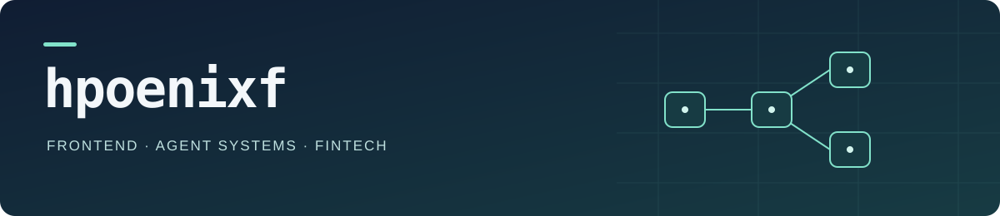

  

  <strong>全栈研发 · Agent 系统 · 金融科技</strong> 
  把复杂需求做成可运行的产品，把真实实践写成可复用的经验。

  
  
  

  
  
  

## 关于我

我是 hpoenixf，拥有 **10 年开发经验、5 年金融业务系统研发经验**。专注金融科技与 AI Agent 工程实践。曾就职于阿里、腾讯及外企。

- **从界面到交付：** 关注设计系统、复杂交互、状态管理与端到端质量。
- **从模型到系统：** 关注工具、上下文、记忆、恢复及交付怎样协同工作。
- **从数据到结论：** 关注金融数据口径、计算可复现和结果可追溯。

## 正在构建

| 项目与文集 | 可以从这里获得什么 |
| --- | --- |
| [Open ETF Agent](https://github.com/hpoenixf/open-etf-agent) | 从一份能打开、能核对来源的报告开始，逐版构建研究 Agent。 |
| [Agent Engineering Suite](https://github.com/hpoenixf/agent-engineering-suite) | 从需求、Spec、架构审查到 History、文档、成熟度与 Roadmap 的研发套件。[阅读完整介绍](https://hpoenixf.com/eff-agent-article/articles/agent-engineering-suite)。 |
| [ETF Agent · Engineering Notes](https://hpoenixf.com/eff-agent-article/) | 从真实开发与故障出发，讲解模块机制、架构取舍与研发方法。 |
| [个人博客](https://hpoenixf.com/) | 前端工程、金融科技、AI 辅助研发及长期实践记录。 |

